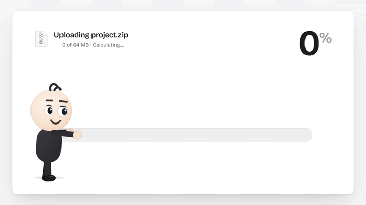

# Stuck at 99%

A tiny worker pushes an upload bar all the way to 99%. The last percent fights back.

One self-contained `index.html`: vanilla JS, SVG and CSS, and every sound is synthesized with Web Audio (no audio files). Open it in a browser. Sound is on by default and starts on your first click or key press, as browsers require. The button in the corner mutes it.

`recording.mp4` is the full 10-second loop at 1920x1080, 60 fps, with sound.

  &nbsp;&nbsp;
  

